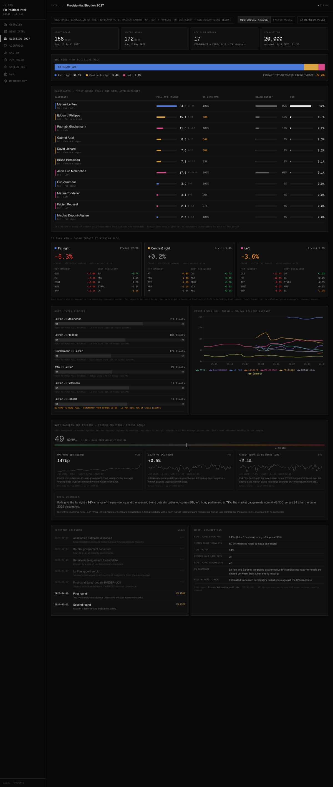
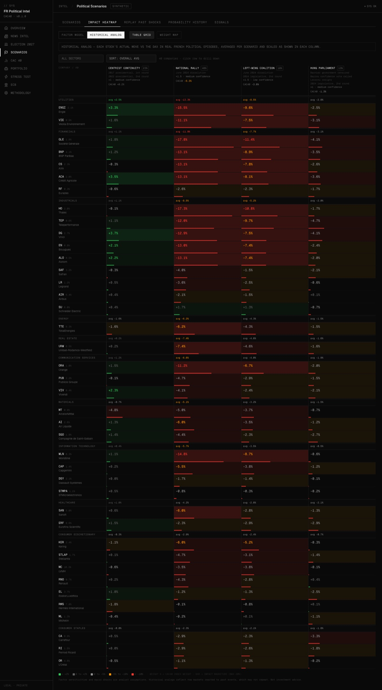
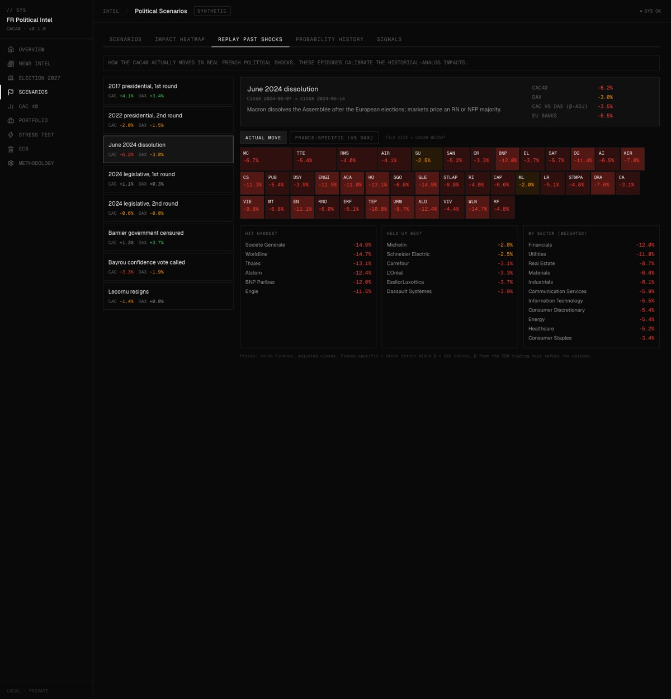
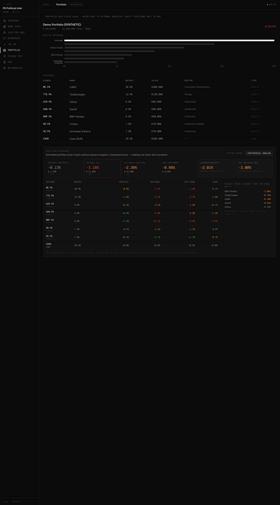
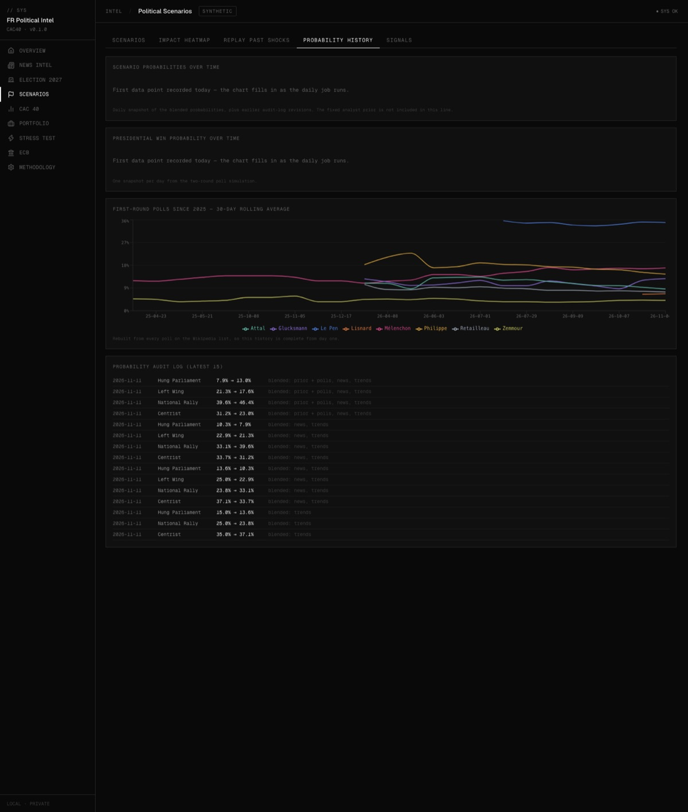

# France Political Intelligence — 2027 Election × CAC 40

**What happens to French stocks if Le Pen, Philippe, Glucksmann or Mélenchon wins in 2027?**

This app turns every published French presidential poll into win probabilities, then estimates how each of the 40 CAC 40 companies (and your own portfolio) would move under each outcome. The estimates come from how those same stocks actually reacted to past French political shocks.

> Research tool. Not investment advice. Runs locally; portfolio data never leaves your machine.



---

## What it does

| Feature | How it works |
|---|---|
| **Presidential 2027 simulation** | Parses every first-round and head-to-head poll on the French Wikipedia poll list, then runs 20,000 two-round Monte Carlo simulations with polling error that widens with time to the vote. Outputs P(reach runoff), P(win), likely runoffs and win odds by political bloc. |
| **Historical calibration** | Event study of 8 real shocks (2017 and 2022 presidentials, June 2024 dissolution, 2024 legislatives, Barnier, Bayrou and Lecornu government collapses). Each stock's move is measured against the DAX (β-adjusted) so global market noise is removed. |
| **Two impact models, side by side** | *Factor model*: sector sensitivities × macro shocks, scaled by each company's French/European/global revenue mix. *Historical analog*: what actually happened in comparable episodes. They often disagree, which is the useful part. |
| **Replay past shocks** | CAC 40 tile map of how every stock moved in each episode, e.g. June 2024: CAC −6.2%, Société Générale −14.9%, BNP −12%. |
| **What markets are pricing** | Stress gauge from the OAT–Bund 10y spread (ECB), CAC 40 vs DAX and French vs European banks, benchmarked against the June 2024 dissolution. |
| **Portfolio election exposure** | Upload a CSV and see your P&L under each scenario, the poll-weighted expectation and your biggest drags. Computed locally. |
| **News intelligence** | RSS feeds from French and international press, ranked by importance, with an AI one-line summary and scenario signal per article (Groq). |
| **Scenario probabilities** | 40% fixed analyst prior + 35% poll simulation + 15% news + 5% Reddit + 5% Google Trends, refreshed daily with a full audit log and history chart. |

| | |
|---|---|
|  |  |
|  |  |

---

## Quick start

Requires Python 3.10+ and Node.js 18+.

```bash
git clone https://github.com/JakubKopczynskii/france-political-intelligence.git
cd france-political-intelligence
pip3 install -r backend/requirements.txt
cd frontend && npm install && cd ..
bash start.sh
```

Open **http://localhost:3000** (API docs at http://localhost:8000/docs).

On first start the backend creates the SQLite database, then fetches polls, prices, historical episodes and the market gauge in the background (about a minute). Data refreshes daily while the backend runs.

### Optional: AI news extraction

Create `backend/.env`:

```bash
GROQ_API_KEY=your_key_here
# GROQ_MODEL=openai/gpt-oss-20b   # default
```

`.env` files are gitignored. Without a key, the news signal falls back to keyword matching.

### Tests

```bash
cd backend && python3 -m pytest -q
```

---

## Data sources and what leaves your machine

| Source | Used for | Sent out |
|---|---|---|
| Wikipedia (fr) poll list | Presidential simulation | Nothing (page download only) |
| Yahoo Finance (yfinance) | Prices, historical episodes, stress gauge | Ticker symbols |
| ECB Data Portal | French and German 10y yields | Series identifiers |
| RSS feeds | News | Nothing |
| Groq (optional) | Article summaries and signals | Article title and snippet only |
| Reddit, Google Trends | Minor sentiment signals | Search keywords |

Portfolio holdings are never sent to any external service.

---

## Architecture

FastAPI + SQLAlchemy/SQLite backend, Next.js 14 frontend, in-process daily job scheduler.
Full architecture, known issues and roadmap: [`docs/ENGINEERING_HANDOFF.md`](docs/ENGINEERING_HANDOFF.md).

## Limitations

- Poll-based, not a calibrated forecast: polling error is an explicit assumption, and candidacy uncertainty only enters through which line-ups pollsters test.
- Historical analogs assume markets react as they did in 2017–2025. Episode choice and scaling are analyst judgements, shown in the app.
- Index weights and revenue geography are approximate (2023–24 data).
- Local, single-user MVP: no authentication, SQLite.

## Stack

FastAPI · SQLAlchemy · SQLite · pandas/numpy · yfinance · BeautifulSoup · Groq · Next.js 14 · React 18 · TypeScript · Tailwind · Recharts
