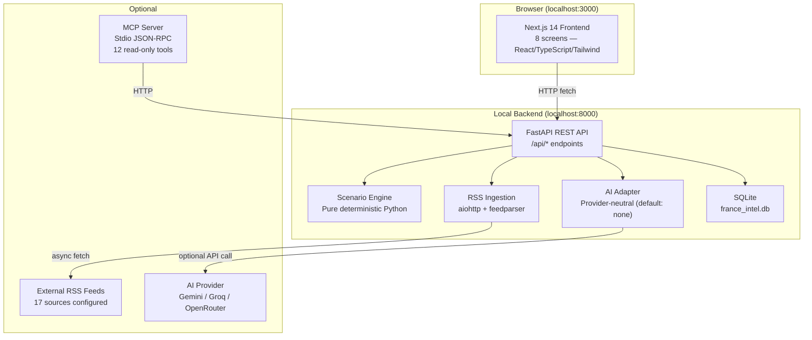
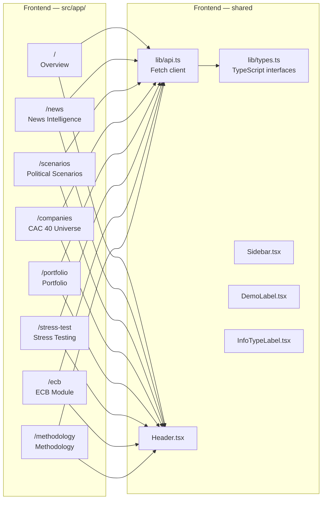
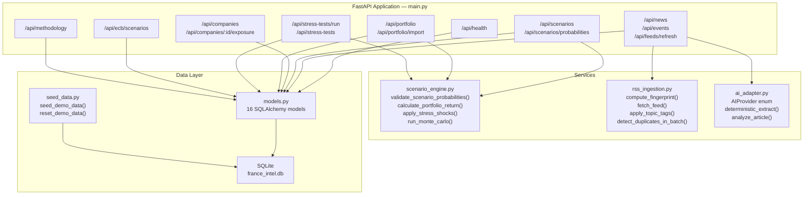
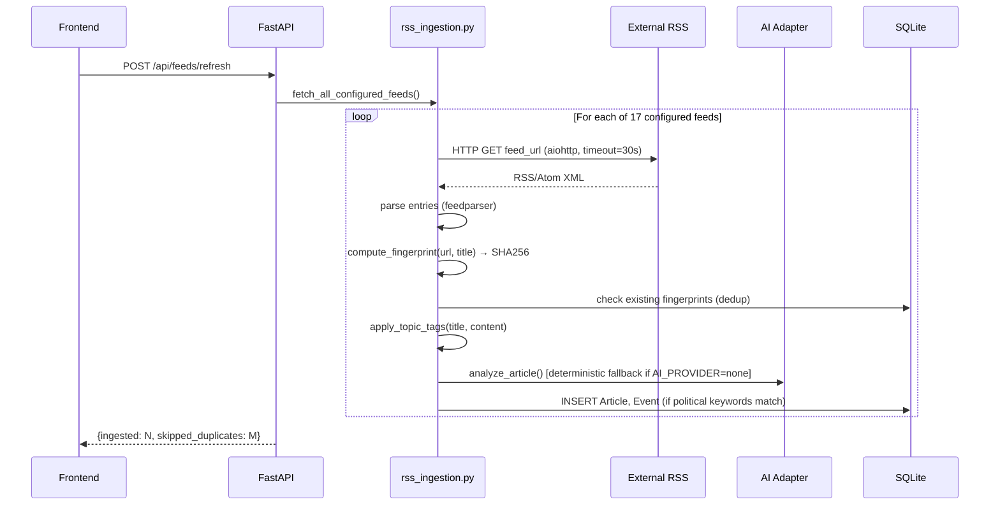
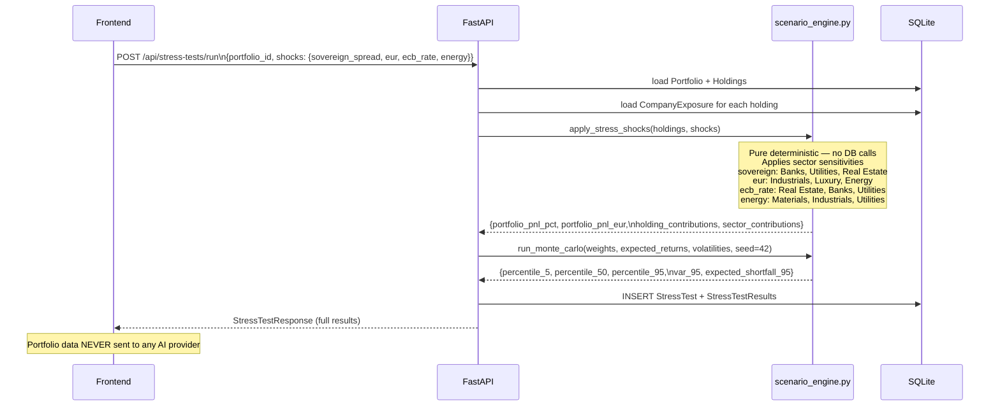
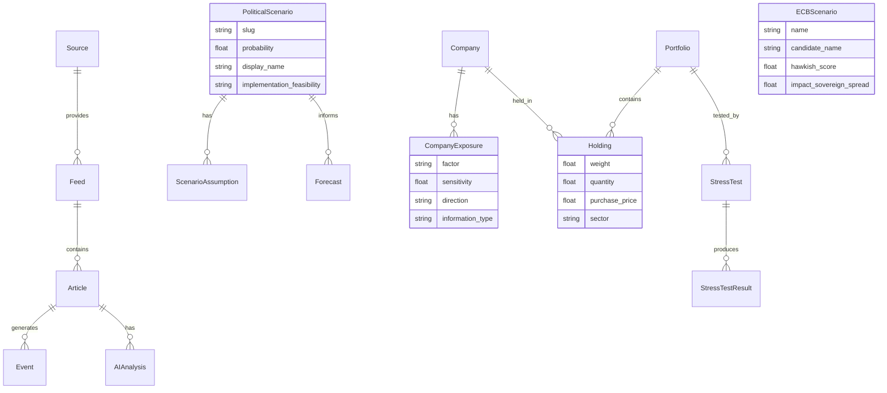
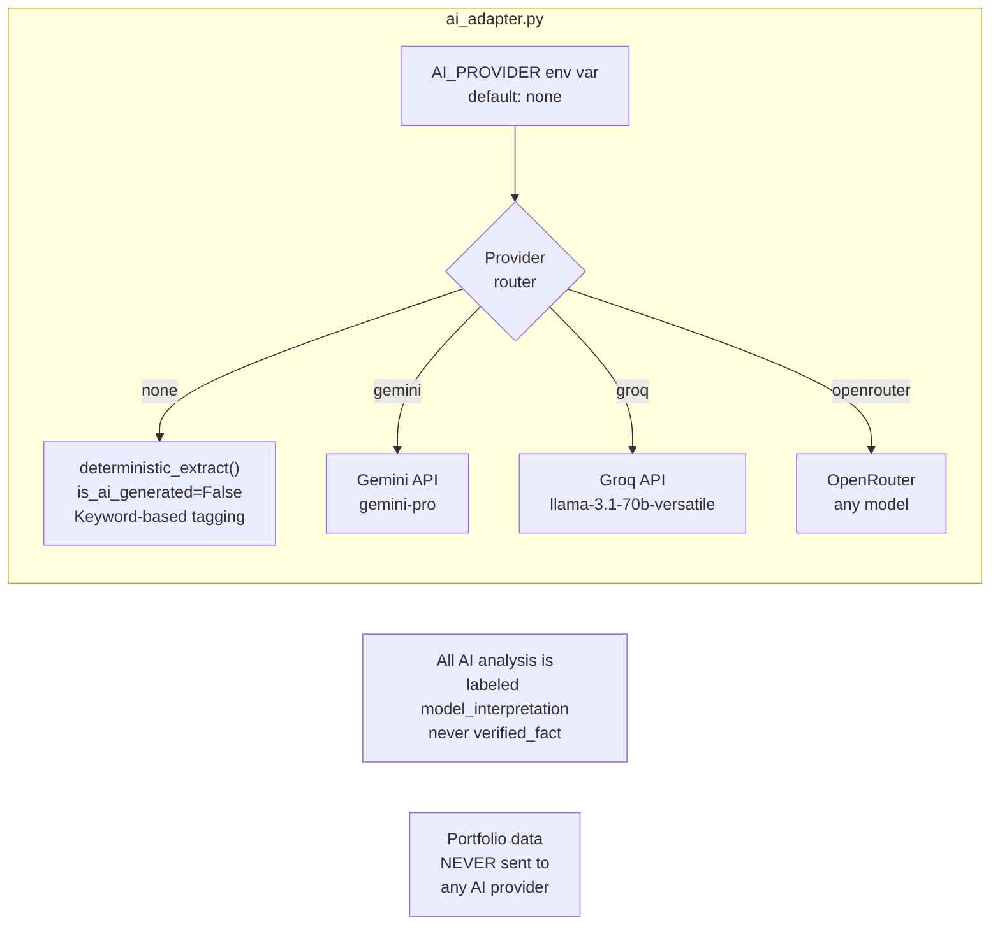
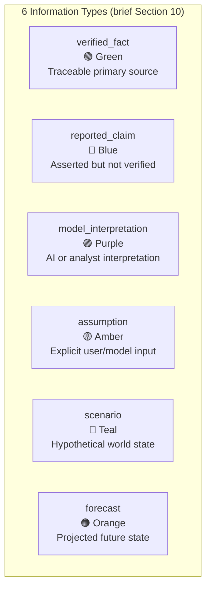
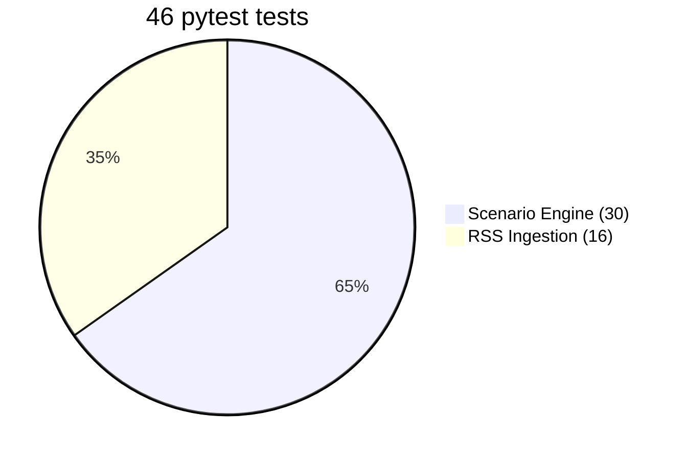
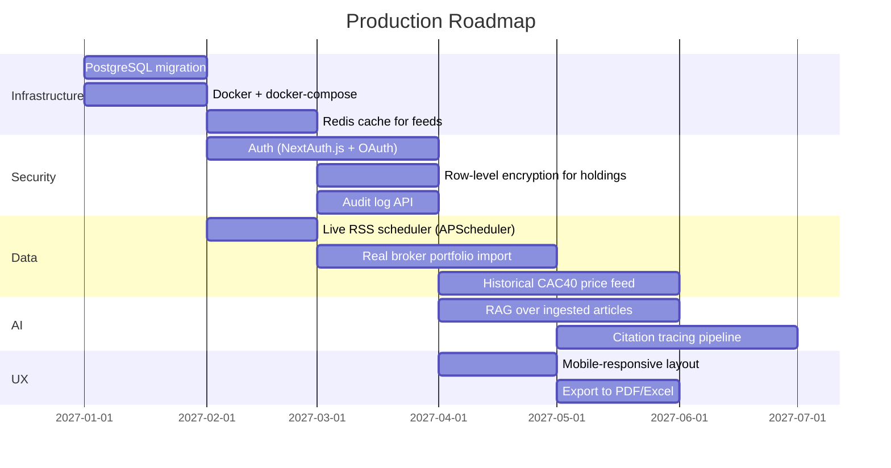

# France Political Intelligence & CAC 40 Portfolio Scenario Simulator
## MVP Architecture & Next Steps

> Version 0.1.0 — Local MVP · All scenario data is illustrative analyst input

---

## 1. System Overview



---

## 2. Component Architecture



---

## 3. Backend Module Map



---

## 4. Data Flow — RSS Ingestion



---

## 5. Data Flow — Portfolio Stress Test



---

## 6. Entity-Relationship Diagram



---

## 7. AI Provider Abstraction



---

## 8. Information Type Taxonomy



---

## 9. Security Architecture

| Concern | Implementation |
|---------|----------------|
| API keys | Never in browser code; read from `.env` server-side only |
| Portfolio data | Stored in local SQLite only; never sent to AI providers |
| Secrets in git | `.gitignore` excludes `.env`, `*.db`, portfolio CSVs |
| Data leaving machine | Only RSS fetch URLs; listed explicitly in Methodology screen |
| AI-generated content | Always labeled `model_interpretation`, never `verified_fact` |
| Synthetic demo data | Prominently labeled `[DEMO / SYNTHETIC DATA]` on every screen |

---

## 10. Test Coverage



**Scenario engine tests cover:**
- `validate_scenario_probabilities` — edge cases, sum tolerance
- `calculate_portfolio_return` — weight validation, weighted sum
- `calculate_expected_return` — multi-scenario weighting
- `apply_stress_shocks` — sector sensitivities, P&L calculation
- `run_monte_carlo` — reproducibility (seed=42), percentile ordering, VaR

**RSS ingestion tests cover:**
- `compute_fingerprint` — consistency, URL normalization
- `apply_topic_tags` — French/English keyword detection, bilingual
- `detect_duplicates_in_batch` — exact match, case sensitivity

---

## 11. File Structure

```
france-political-intelligence/
├── backend/
│   ├── main.py                    # FastAPI app + lifespan
│   ├── database.py                # SQLAlchemy engine + session
│   ├── models.py                  # 16 SQLAlchemy models
│   ├── seed_data.py               # Demo data (40 CAC40, 4 scenarios, portfolio)
│   ├── requirements.txt
│   ├── routers/
│   │   ├── health.py
│   │   ├── news.py
│   │   ├── scenarios.py
│   │   ├── companies.py
│   │   ├── portfolio.py
│   │   ├── stress_tests.py
│   │   ├── ecb.py
│   │   └── methodology.py
│   ├── services/
│   │   ├── scenario_engine.py     # Pure deterministic functions
│   │   ├── rss_ingestion.py       # Async feed fetcher + dedup
│   │   └── ai_adapter.py          # Provider-neutral AI abstraction
│   └── tests/
│       ├── test_scenario_engine.py  # 30 tests
│       └── test_rss_ingestion.py    # 16 tests
├── frontend/
│   ├── src/
│   │   ├── app/
│   │   │   ├── layout.tsx          # Root layout (Sidebar + Inter)
│   │   │   ├── page.tsx            # Overview
│   │   │   ├── news/page.tsx       # News Intelligence
│   │   │   ├── scenarios/page.tsx  # Political Scenarios
│   │   │   ├── companies/page.tsx  # CAC 40 Universe
│   │   │   ├── portfolio/page.tsx  # Portfolio + CSV import
│   │   │   ├── stress-test/page.tsx# Stress Testing
│   │   │   ├── ecb/page.tsx        # ECB Module
│   │   │   └── methodology/page.tsx# Methodology & Audit
│   │   ├── components/
│   │   │   ├── layout/Sidebar.tsx
│   │   │   ├── layout/Header.tsx
│   │   │   ├── ui/DemoLabel.tsx
│   │   │   └── ui/InfoTypeLabel.tsx
│   │   └── lib/
│   │       ├── api.ts              # Fetch client
│   │       └── types.ts            # TypeScript interfaces
│   └── package.json
├── data/
│   ├── rss_sources.yaml           # 17 configured feed URLs
│   └── france_intel.db            # Auto-created SQLite (gitignored)
├── mcp_server.py                  # Optional local MCP (12 tools)
├── start.sh                       # One-command startup
├── .env.example
└── .gitignore
```

---

## 12. Production Roadmap



### Key gaps vs. production

| Area | MVP | Production |
|------|-----|-----------|
| Database | SQLite (local) | PostgreSQL (server) |
| Auth | None | OAuth2 + JWT |
| Portfolio import | CSV upload | Broker API / IBKR |
| RSS scheduling | Manual trigger | APScheduler (hourly) |
| AI analysis | Deterministic fallback | Full RAG pipeline |
| CAC40 prices | Synthetic seed data | Live market data feed |
| Scenario calibration | Manual probability sliders | Bayesian update on news |
| Deployment | localhost | Docker + reverse proxy |
| Monitoring | None | Prometheus + Grafana |
| Backup | None | Automated DB backups |

---

## 13. Data Leaving the Machine

The following **and only the following** data leaves localhost in this MVP:

| What | Where | When |
|------|-------|------|
| HTTP GET to RSS feed URLs | 17 configured external sources | On manual "Refresh Feeds" trigger |
| HTTP POST to AI provider API | Gemini / Groq / OpenRouter (if configured) | On article analysis, when `AI_PROVIDER ≠ none` |

**What never leaves:**
- Portfolio holdings, weights, or values
- User-uploaded CSV files
- SQLite database contents
- Any personal data

---

## 14. Known Limitations (MVP)

1. **No authentication** — anyone with localhost:3000 access can read all data
2. **Synthetic market data** — CAC40 exposures and prices are illustrative, not live
3. **RSS fetch is manual** — no background scheduler; must click "Refresh Feeds"
4. **Scenario probabilities are user-set** — not calibrated against prediction markets or news
5. **Monte Carlo uses diagonal covariance** — no correlation matrix between assets
6. **ECB candidate profiles are illustrative** — not authoritative analyst research
7. **AI analysis off by default** — `AI_PROVIDER=none` means all tagging is keyword-based
8. **No data export** — cannot export stress test results or portfolio analysis to PDF/Excel
